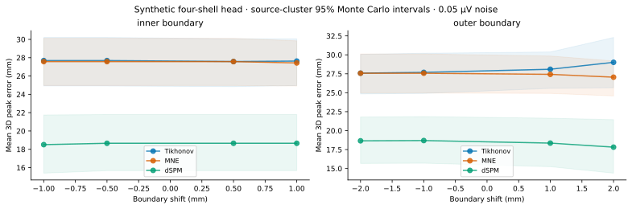
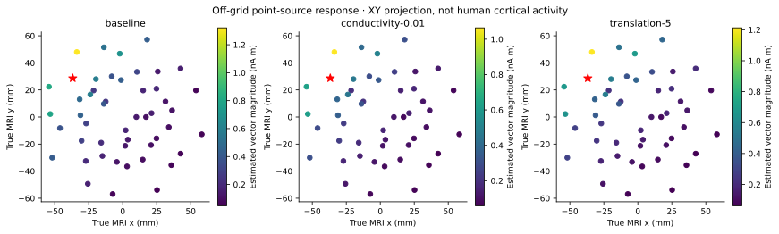

# Anatomical error propagation: executed synthetic controls

The frozen [protocol](SOURCE_UNCERTAINTY_PROTOCOL.md) separates physical truth,
independently generated off-grid dipoles, measurements and perturbed estimated
models. The MNE sphere calculation is conductivity-aware; it is not Soma's
separate MRI/BEM pipeline or the dimensionless toy forward model.

There are 49 planned configuration rows, representing 45 distinct physical
settings. Four single-factor settings occur again in the factorial table. They
are repeated controls, not independent anatomy samples. Twelve seeded generator
locations/orientations on one fixed head produce 204 distinct measurement vectors
(one noiseless plus eight draws at each of two noise levels per source). These
same vectors are reconstructed for every model. The 29,988 planned reconstruction
rows are not 29,988 independent experiments: 24,480 computed and 5,508 are explicit
failures. All rows and planned missingness remain public synthetic artifacts.

## Boundary perturbations

Inner-skull/CSF outer radius shifts are −1, −0.5, +0.5, +1 mm. Outer-skull radius
shifts are −2, −1, +1, +2 mm, with the scalp fixed. Shells remain nested in the
single-factor conditions. These smooth global radius shifts are controlled
segmentation-boundary surrogates, not a validated distribution of local MRI
segmentation mistakes. They cannot measure effects of foramina, local skull
thickness, anisotropy, lesions, cortical folding or segmentation topology errors.

At 0.05 µV noise, +2 mm outer-skull displacement changes MNE's mean peak error
from 27.5740 to 27.0516 mm (paired difference −0.5224 mm), while Tikhonov changes
from 27.6892 to 29.0132 mm (+1.3240 mm). A mismatched model sometimes partially
compensates a method's regularization/grid bias; better peak distance does not
establish a better anatomical model. Broad spatial dispersion and severe peak
amplitude attenuation persist. There is no universal monotonic accuracy claim.

## Independent numerical controls and resolution limits

Soma's SVD Tikhonov kernel agrees with an independently solved linear system to
relative error at most 3.39e−14; maximum normal-equation residual is 5.58e−15.
MNE kernel application is tested against direct MNE inverse application. The
average-reference forward rank is 31 for 32 sensors; 144 free Cartesian current
components are reconstructed. Matched resolution K G_estimated has rank at most
31, not an identity on the source grid. Its Frobenius magnitude and the distinct
mismatched response K G_truth are recorded. Vector-magnitude maps are nonlinear
summaries, not a new fixed linear resolution operator.

Noiseless mean peak distances on 48 candidates are 26.823/27.284/17.793 mm for
Tikhonov/MNE/dSPM. Doubling the prespecified grid to 96 changes them to
20.010/19.965/12.735 mm. The average nearest possible grid distance changes from
15.251 to 10.505 mm. Thus grid quantization and method bias are major limitations;
these coarse-grid values are not high-precision cortical localization estimates.
The denser grid remains a sensitivity control and does not replace the frozen
primary grid after inspecting outcomes.

Central-difference changes at 2→1 mm and 1→0.5 mm are 31.96% and 5.53%. This is
finite-step sensitivity evidence, not a certified converged anatomical derivative.
MNE equivalent-source fit residuals are approximate-series diagnostics, not PDE
residuals. Four factorial conditions exceed the frozen 0.001 fractional fit
threshold (observed RV approximately 0.629957) and are rejected. No tolerance was
relaxed to recover those cells. Full four-factor decomposition is consequently
not estimable. Estimable pairwise differences-in-differences are descriptive
conditional contrasts; they are not variance-component attribution or human
causal effects.

## Real-anatomy boundary

No real human source localization, anatomy download or EEG acquisition occurred.
Existing IBSR tissue benchmarks remain historical evidence about brain tissues,
including the very poor CSF score (Dice 0.1113 in that frozen benchmark). They do
not validate skull/scalp surfaces, conductivity, MRI-to-electrode correspondence
or BEM conductor nesting. MRBrainS permission remains insufficient for this study.
BrainWeb and Mindboggle cover different tissue/cortical reference ontologies and
also cannot certify skull conductors by substitution. Those limitations are not
revised by synthetic success.

