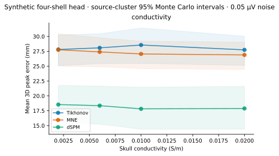
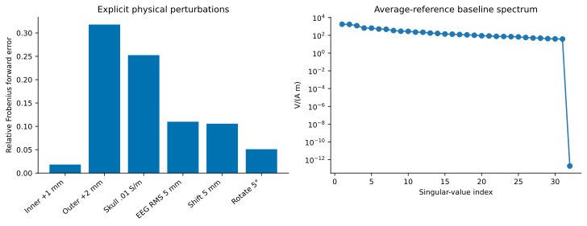

# Skull conductivity sensitivity

The baseline is a freshly computed MNE four-shell sphere: brain/CSF/skull/scalp
conductivities 0.33/1/0.004/0.33 S/m. Skull sensitivity values are
0.002, 0.006, 0.01 and 0.02 S/m; all other parameters remain frozen. These are
hypothetical mismatches, not estimated conductivities or a calibrated human
population prior. [MNE's implementation](https://mne.tools/stable/documentation/implementation.html)
uses an equivalent-source approximation to the layered sphere.
[Unnwongse et al. (2023)](https://pmc.ncbi.nlm.nih.gov/articles/PMC9942548/)
investigated a wider conductivity range with invasive human reference evidence;
Soma has no such evidence here and does not reuse that paper's performance as
its own. The synthetic M26 experiment does not establish an optimal conductivity.

At 0.05 µV noise, changing the assumed skull value from 0.004 to 0.01 S/m changes
mean peak distance from 27.689 to 28.558 mm (Tikhonov), 27.574 to 27.052 mm (MNE)
and 18.657 to 17.821 mm (dSPM). All baseline and perturbed source-cluster intervals,
per-generator values and missingness are in `experiments/milestone26/summary.csv`
and `conductivity-cases.csv`. The paired MNE difference is −0.522 mm, not evidence
of better real anatomy. The 0.02 S/m condition changes the forward matrix by
39.92% in relative Frobenius norm. Operator changes need not map monotonically
to peak-grid changes.

The frozen inverse regularization remains 0.001 at one baseline spectral scale
for Tikhonov and lambda2=1/9 with no depth weighting for MNE/dSPM. Method-specific
normalization is part of the documented algorithm, not target-outcome tuning.
Peak amplitude ratio minus one is a distributed inverse's largest vector current
relative to the true 10 nA m dipole. It is not a conserved total-current estimate.
Baseline Tikhonov and MNE mean peak biases at 0.05 µV are −82.74% and −89.36%.
dSPM is dimensionless; physical amplitude bias is explicitly unavailable.

Retained forward condition numbers range from 19.49 to 77.87 across valid models.
This excludes the average-reference null direction and does not describe an
invertible 144-component source problem. Four combined thin-scalp/high-skull
conditions have gross approximation residuals and remain failed. Their responses
are not used for interaction estimates or silently replaced by other conductors.

