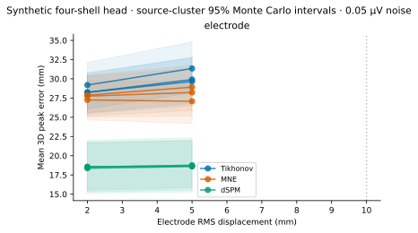
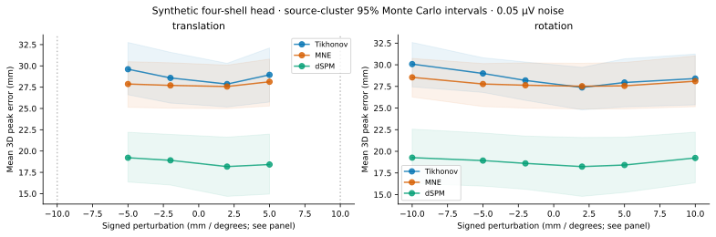
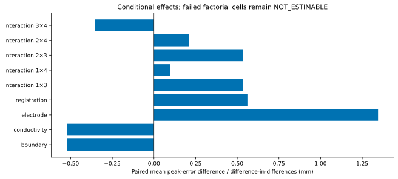

# Electrode and MRI-to-head uncertainty

Synthetic electrodes start on the 90 mm scalp sphere. Independent fixed patterns
have exactly 2, 5 or 10 mm RMS 3D displacement, not per-coordinate standard
deviation. Three seeded patterns are retained at each level. Errors are not
clipped or projected back to the scalp. Scalp-fit RMS and lead-field differences
are recorded separately from source error. All three 10 mm patterns place at
least one sensor inside the innermost modeled shell and are rejected; each rejected configuration accounts for exactly 612 planned
source/method/noise rows. There is no favorable replacement pattern.

For the first 5 mm electrode pattern at 0.05 µV noise, MNE peak distance increases
from 27.574 to 28.919 mm (+1.345 mm), Tikhonov from 27.689 to 29.911 mm (+2.221 mm),
and dSPM from 18.657 to 18.766 mm (+0.109 mm). The other patterns remain in the
figure and tables. One pattern is illustrative, not an optimized choice.

The declared registration is HEAD→MRI, in metres. MNE receives its inverse,
MRI→HEAD. The estimated conductor center and candidate source locations both
follow that inverse transform. Physical truth and measurements stay fixed. Peak
distance is evaluated in the true, unperturbed MRI coordinate system using source
identities, not in the incorrectly registered estimated head coordinates. A separate
geometric RMS measures transform displacement across the candidate points. Positive
x translation and positive z rotation follow the right-handed transform definition;
both signs are swept at 2/5/10 mm or degrees.

A +5 mm translation gives MNE mean distance 28.135 mm; a +5° rotation gives
27.566 mm. Their paired differences are +0.561 and −0.008 mm. The ±10 mm
translations put electrodes inside the estimated inner shell and are rejected.
Spherical isotropy suppresses anatomical rotation effects: the center is unchanged
by a pure rotation, whereas the labeled source grid moves. This model does not
capture how a rotated nonspherical skull changes conduction. Geometric fit and
neural source accuracy are distinct; neither can certify real coregistration here.

The joint factorial includes boundary, conductivity, electrode and translation
errors. Among estimable MNE contrasts at 0.05 µV, the electrode×translation
interaction is −0.353 mm as a difference-in-differences. This is a conditional
point contrast with paired generator/noise structure, not statistical significance
or an additive partition of human uncertainty. Boundary×conductivity is unavailable
because the requisite high-high cells fail the approximation tolerance.

