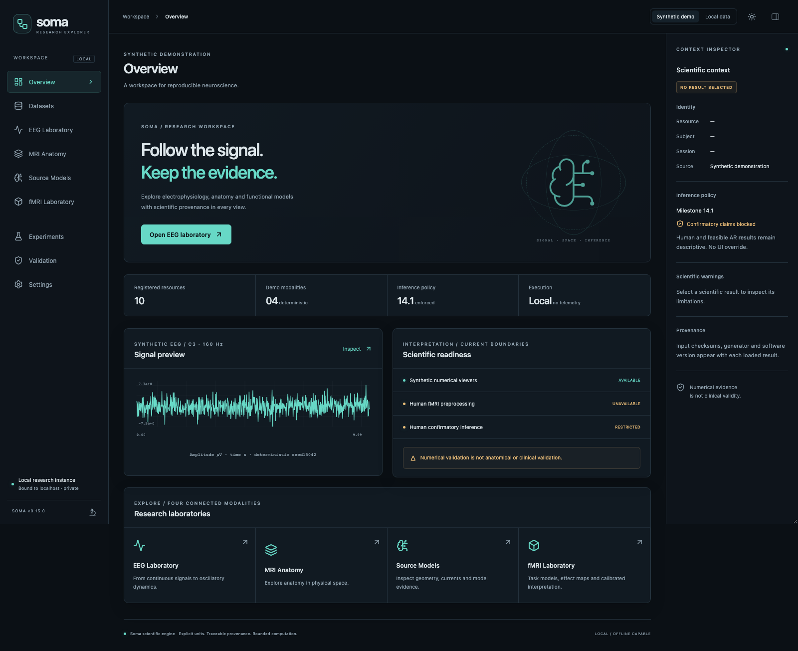
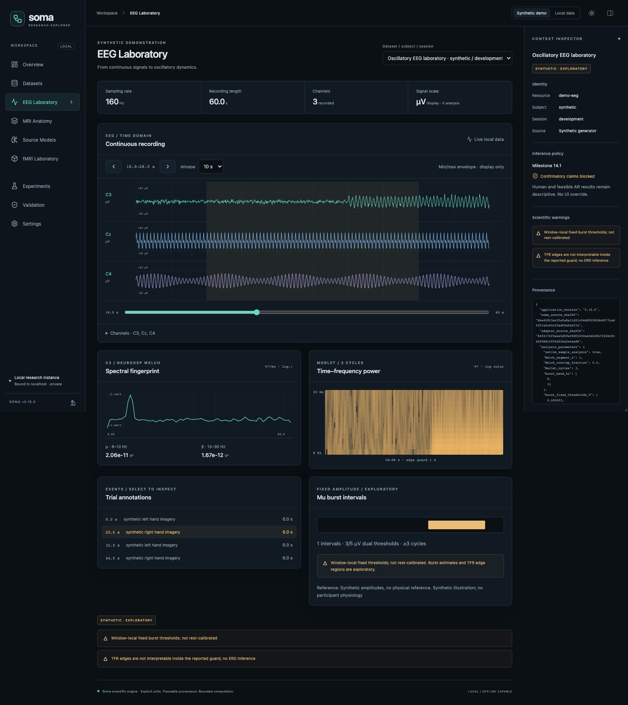
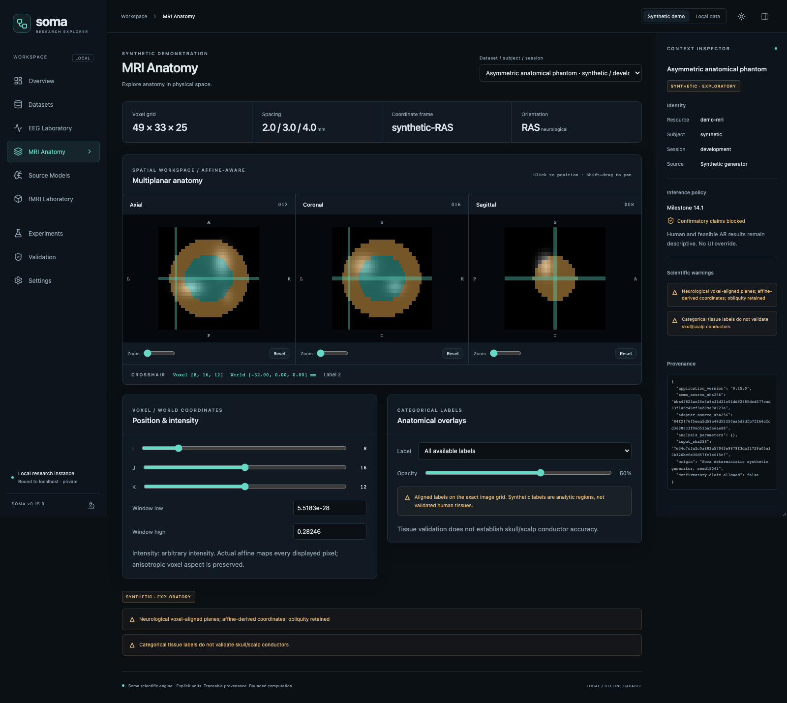
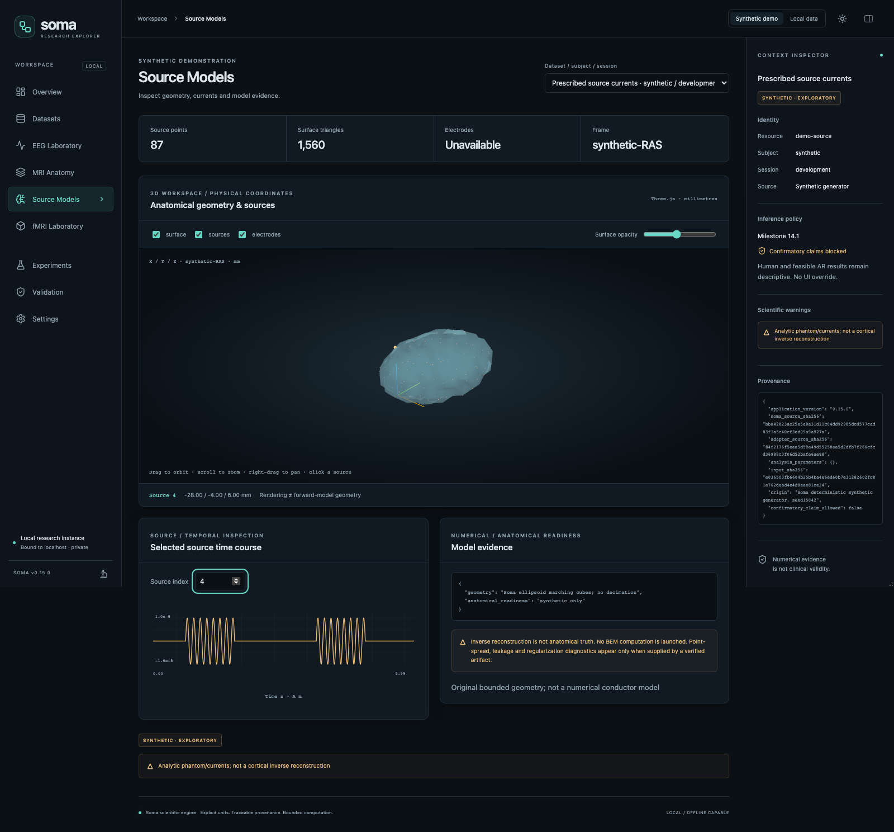
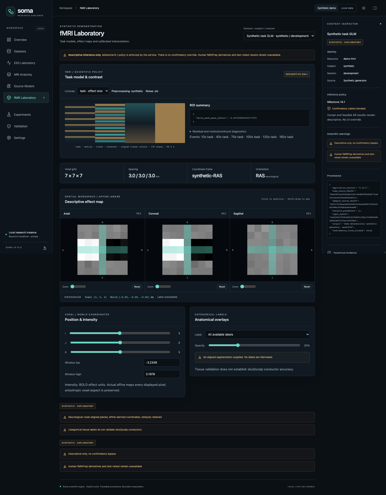
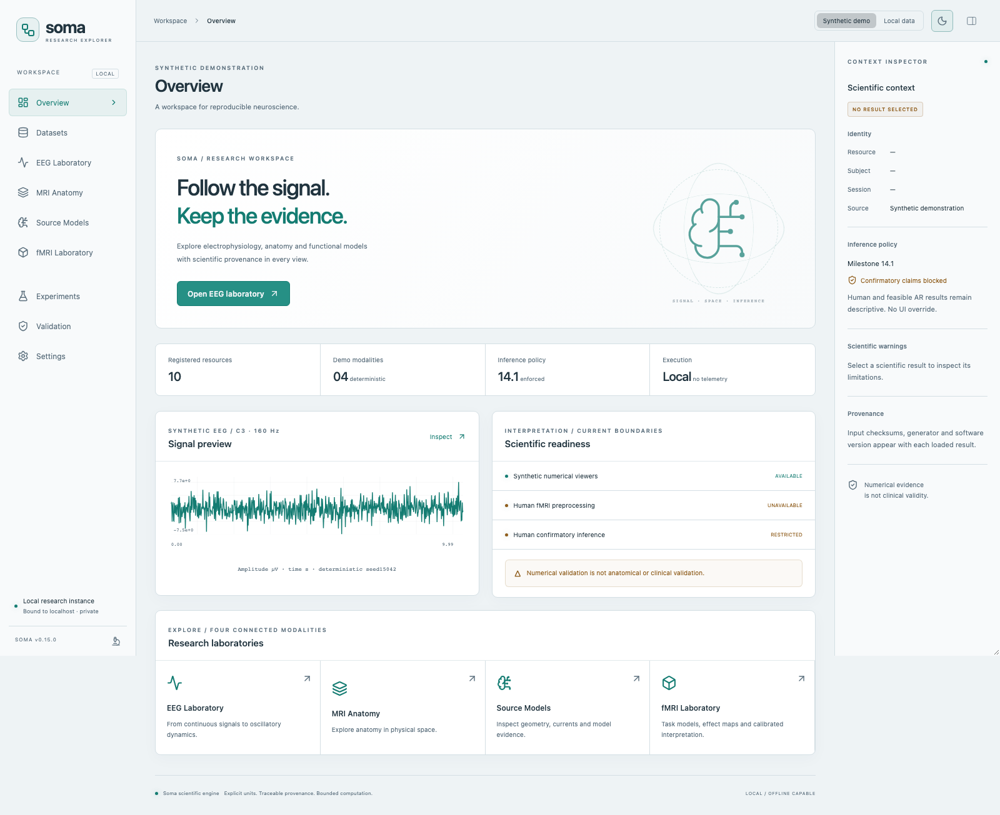

# Soma Explorer visualization conventions

## EEG and time-frequency

Native samples/PSD use V and V²/Hz; time traces explicitly convert V to µV for
presentation. Display reduction returns min/max envelopes plus bin means; it is
not a resampled scientific signal. Analyses never use display-reduced points.
Plot axes use returned time/frequency coordinates. Annotation labels come from
recorded annotations and Soma's EEGBCI run mapping; synthetic trials say synthetic.
Selecting a trial updates window, PSD, Morlet representation and bursts together.
No motor execution/imagery equivalence or physiological validation is implied.

TFR colors show log10 wavelet power, not PSD density or baseline ERD.
The GLM design uses a separate signed, shared linear color scale and scan order
from top to bottom; regressor signs are never removed by a power colormap.
Edge guards are explicit. Fixed-threshold window-local bursts are exploratory and
may change with the analysis window; they are not the full rest-calibrated Soma
cohort workflow. Quality warnings and recorded reference appear near each viewer.

## MRI

The server uses Soma's NIfTI geometry validation, converts declared spatial units
to mm and losslessly reorients voxel axes to canonical order. Axial=(I,J),
coronal=(I,K), sagittal=(J,K). Screen row0 is the largest sampled vertical index;
neurological +R is screen-right in axial/coronal. Orientation labels derive from
the actual affine, not filenames. Oblique images remain voxel-aligned planes and
are labeled as such; no claim of world-orthogonal reslicing is made.

Every returned slice includes a full4×4 pixel-to-world matrix including display
stride and vertical reversal. Crosshair selection updates all planes and the
actual world position using the image affine. Integer pixel coordinates denote
voxel centers; the canvas adds its half-pixel center offset when drawing crosshairs,
so the marker does not drift to a pixel boundary. Anisotropic pixel aspect is based
on physical affine-column lengths, not an isotropic assumption. Zoom/pan affect
presentation only; picking accounts for transformed canvas bounds. Arbitrarily
sheared voxel grids remain schematic rectangular voxel views: affine coordinate
reporting is exact, but shear angles are not rendered as parallelograms. Use a
validated external reslicing workflow when geometrically faithful world planes
are required.

Segmentation is categorical and sampled on exactly the same voxel grid, with
label selection/opacity and no interpolated labels. The demo's analytic regions
are not validated human tissues. Frame names identify the dataset space and are
never silently synchronized across dataset changes. A matching affine alone is
not evidence of correct anatomy or participant identity.

## 3D and source models

All browser geometry is in millimetres; the service's transformations reuse Soma's
metre-based frames. The renderer names the actual frame (synthetic RAS or MNE
head), uses Z-up and displays XYZ axes. Cortex/source/electrode coordinates share
one verified frame. Orbit, zoom, right-drag pan, layer visibility and opacity are
interactive; source picking/index selection updates marker and time course.

The local template example displays1284 source vertices and2560 cortical
triangles from existing ico3 source-space connectivity. Hemisphere IDs and the
MRI-to-head transform are verified against the historical source bundle. This is
reduced display geometry, not a replacement BEM or a full-resolution cortical
surface. The demo uses an analytic ellipsoid with prescribed currents, never a
fake human inverse reconstruction. Missing surfaces/electrodes/PSFs are explicitly
unavailable rather than invented.

Amplitude colors reflect peak absolute source current, not statistical
significance. Matching cortical vertices receive the same amplitude overlay;
interpolation across reduced display triangles is a rendering choice, not new
numerical source estimation. Effect maps without an aligned anatomical underlay
are shown as standalone descriptive maps, never as registered anatomy. Time courses retain A·m units. Available PSFs are signed linear gain
with source-index abscissa; leakage/dispersion diagnostics come from Soma's
existing resolution implementation. Historical regularization figures can be
browsed as approved experiment artifacts; opening a page never launches a solver.

## Actual application captures

All committed screenshots show synthetic data from the running application:

Local participant images/individual screenshots must remain ignored and are not
release artifacts. Captures are made by Playwright only when explicitly enabled.
